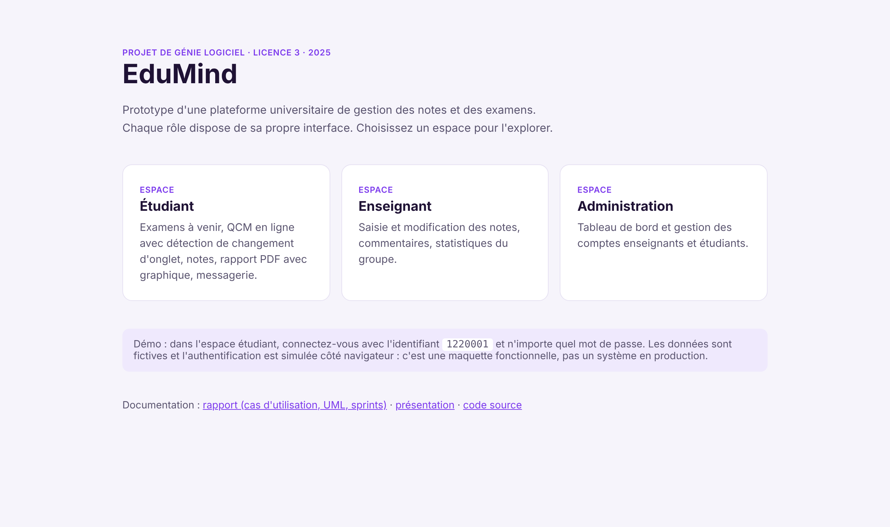
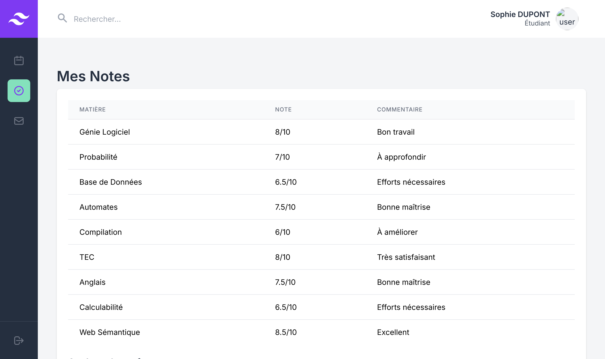
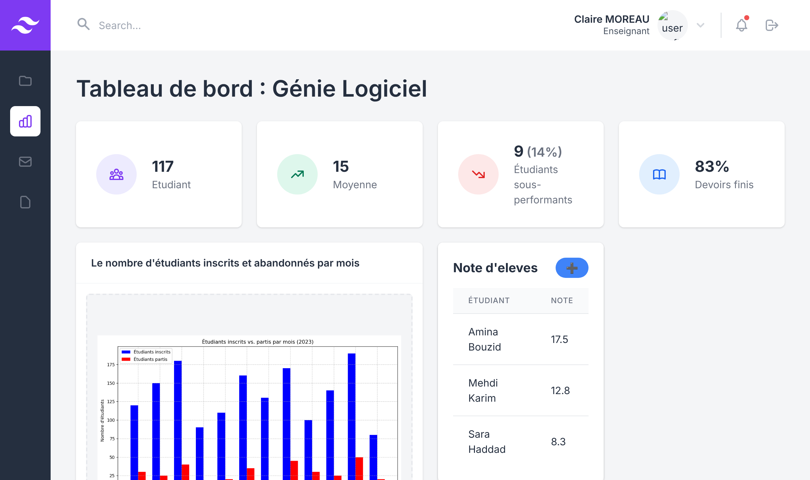
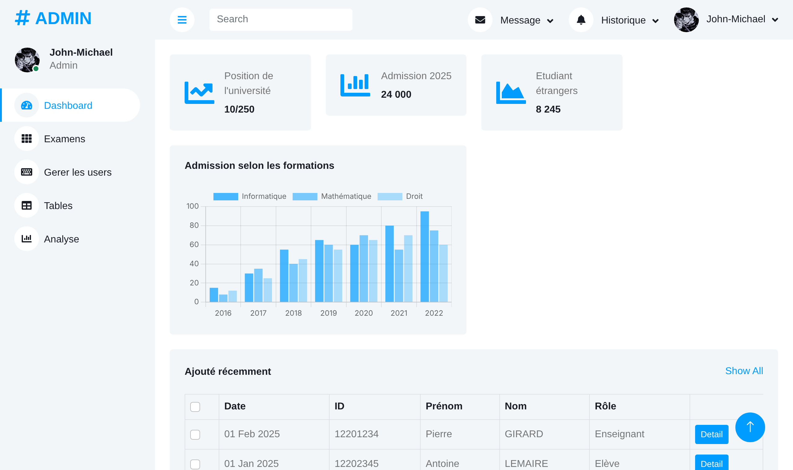

# EduMind: grade & exam management platform (prototype)

Software engineering team project, Licence 3 Informatique, Université Sorbonne Paris Nord (2025).
Team of five: John-Michael JENY JEYARAJ, Vidur PARAKARAN, Madina ARBOUZ, Mathurin MARTEL, Vu Hoang Hai NGUYEN.

The brief: specify and prototype a centralised platform where **students** see their exams and grades,
**teachers** enter and correct grades, and **administrators** manage accounts. The core deliverable
was the software engineering process (requirements, UML modelling, agile planning), with an
interactive front-end prototype for each role.

**[Live demo](https://jmjjprojects.com/edumind/)** · [Report (FR)](docs/rapport-genie-logiciel.pdf) · [Slides (FR)](docs/presentation.pdf)



## Process & modelling

- **Requirements analysis**: actors, preconditions, scenarios and postconditions for each role
  (e.g. a teacher edits grades, the system validates ranges and "ABS", students are notified)
- **UML**: use-case, class, sequence, activity, state-transition and collaboration diagrams
- **Agile (Scrum) planning**: 4 sprints (1 user management, 2 exams & grades, 3 messaging,
  4 security & backups), each with a sprint review, plus a full Gantt chart
- **Roles in the team**: product owner / analyst, developers, tester

## Prototype

| Student | Teacher | Admin |
|---|---|---|
|  |  |  |

**Student space** ([`etudiant/`](etudiant/index.html)): upcoming exams, an online multiple-choice exam that is
voided if the student switches tab (Page Visibility API), grade table, one-click **PDF grade report with a
Chart.js bar chart** (jsPDF), and messaging between students.
Demo login: ID `1220001`, any password.

**Teacher space** ([`enseignant/`](enseignant/index.html)): course dashboard with KPIs, enrolment chart, and a student grade list.

**Admin space** ([`admin/`](admin/index.html)): dashboard and account management (add/remove teachers and
students). Built on the free *DASHMIN* Bootstrap template.

## Run locally

Plain HTML/CSS/JS, no build step. The admin page loads its data with `fetch`, so use a local server:

```bash
python -m http.server 8000   # then open http://localhost:8000
```

## Limitations (it's a prototype)

Authentication and data live entirely in the browser (hard-coded demo users, accounts in text files),
so nothing is persisted or secured. In the design, those responsibilities belong to a back-end with
hashed passwords and role-based access control. My separate project
[StockageCloud](https://github.com/JMJJ-projects/StockageCloud) shows that side: server-side auth,
encryption and access control in Flask. All names and grades in the demo are fictional.
